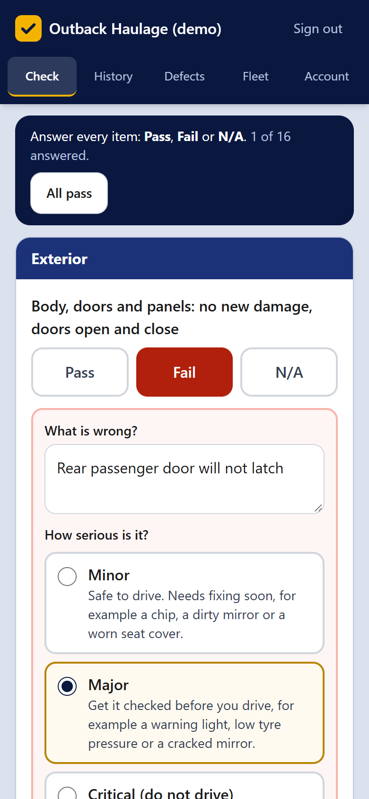
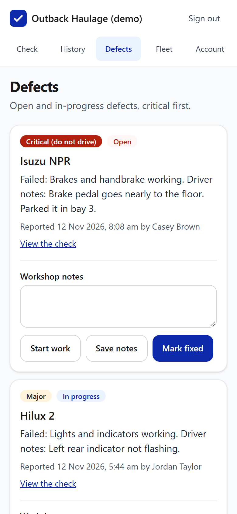
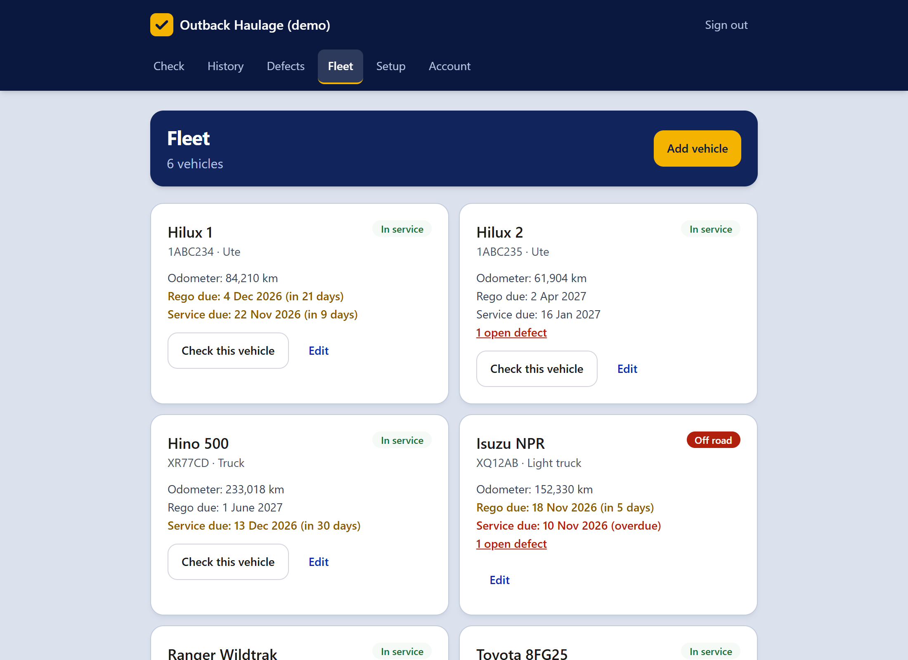

# PreStart Lite

**Daily vehicle pre-start checks and a defect workflow for small fleets. Free, open source, and it runs in your own
Cloudflare account on the free plan.**

Drivers mark every item Pass, Fail or N/A on their phone before they drive. Each failed item goes to the workshop
queue with its own note, severity and photos, and the driver is told plainly what to do next: safe to drive, get it
checked first, or do not drive. A critical fault takes the vehicle off the road until the workshop marks it fixed. Every
check is kept, with who, when and every answer, ready for safety audits and insurers.

[](https://deploy.workers.cloudflare.com/?url=https://github.com/Red-Center-Studio/prestart-lite)

**[Try the live demo](https://prestart.redcenterstudio.com)** (one-click sign-in, resets nightly) ·
**[PreStart product page](https://redcenterstudio.com/prestart/)** (Lite, Pro and done-for-you setup)

| Daily check (phone)                                   | Defect queue (phone)                                         |
| ----------------------------------------------------- | ------------------------------------------------------------ |
|  |  |



## What it does

- **Daily checks in under a minute.** Pick the vehicle, enter the odometer, mark each item Pass, Fail or N/A (or
  "All pass"). A failed item asks what is wrong, how serious it is, and takes up to 3 photos.
- **Clear next steps.** Minor: safe to drive, the workshop is told. Major: do not drive until a supervisor or the
  workshop says it is safe. Critical: the vehicle goes off road. Each level is explained on the form, so drivers pick
  the right one.
- **Ready-made checklists.** Car, ute or 4WD, truck, trailer, forklift and plant, grouped into sections like Tyres,
  Lights and Brakes. Add one in a click, then edit it to suit.
- **Known faults.** Picking a vehicle shows its open faults, so the next driver knows what is already reported.
- **Defect queue.** Critical faults first. The workshop can start work, add notes and mark things fixed.
- **Off road means off road.** A critical fault takes the vehicle off road. It comes back only when no critical defect
  is left on it, and drivers cannot submit checks on it in the meantime.
- **Fleet view.** Odometer, rego and service due dates, highlighted when they are close or overdue.
- **History.** Filter by vehicle, driver, date and pass or fail. Drivers see their own checks; the workshop and admins
  see everything.
- **Roles.** Driver, Workshop and Admin. New sign-ups wait for an admin to approve them. The first account on a new
  install becomes the Admin.
- **Private photos.** Shrunk on the phone before upload, stored in your own Cloudflare R2 bucket and only shown to
  people allowed to see them.
- **Built for yards.** Mobile-first pages, big tap targets, clear messages when the signal drops.

## Why it is built this way

- **One Cloudflare Worker** serves everything: pages, forms and photos. Nothing else to host.
- **Free at small-fleet scale.** Workers, D1 (database) and R2 (photos) free plans cover a typical small fleet.
- **Readable code.** [Hono](https://hono.dev) with server-rendered JSX, [Drizzle](https://orm.drizzle.team) for the
  database, [Better Auth](https://www.better-auth.com) for sign-in, Tailwind CSS, TypeScript in strict mode.
- **Tested.** Unit tests run inside the real Workers runtime against a real local database, covering every permission
  rule and every business rule. End-to-end tests drive a real browser at desktop and phone sizes.

## Get started

**Fastest:** click **Deploy to Cloudflare** above. Cloudflare copies this repository into your GitHub account,
creates the database and photo storage, asks you for one secret (`AUTH_SECRET`: paste a long random string, at least 32
characters) and deploys it. Open the address it gives you and create the first account: it becomes the Admin.

**Step by step:** follow **[SETUP.md](SETUP.md)**. It is written for people who have never deployed code: about 20
minutes from download to your own live PreStart.

Short version for developers:

```bash
npm install
npx wrangler login
npx wrangler secret put AUTH_SECRET
npm run build:css && npx wrangler deploy   # first time only: creates the database and photo bucket
npm run deploy                             # applies migrations, then deploys
```

Then open the address it prints and create the first account (it becomes the Admin).

## Make it yours

See **[CUSTOMISING.md](CUSTOMISING.md)** for renaming roles and statuses, changing the standard checklist, colours,
time zone, email provider and permissions.

## PreStart Pro

The Pro edition adds the features bigger fleets ask for:

- QR code stickers per vehicle that open the check with the vehicle already picked
- Instant email to the workshop and admins when a critical defect is reported
- Daily email reminders before rego and service are due
- CSV export of checks and defects for audits and insurers
- Offline checks that send themselves when signal returns
- Region settings: kilometres or miles, date format, "Rego" or "Plate"

Pro is coming soon. Get notified, or have PreStart set up for you, at
[redcenterstudio.com/prestart](https://redcenterstudio.com/prestart/).

## Development

```bash
npm run dev          # local app at http://localhost:8787 (copy .dev.vars.example to .dev.vars first)
npm run seed:local   # load sample data into the local database
npm run check        # type check, lint, formatting and unit tests
npm run test:e2e     # end-to-end browser tests (uses Microsoft Edge or Chrome)
```

Project layout:

```
src/
  index.ts          app entry: middleware, routes, error pages, daily cron
  labels.ts         every caption, role and status name
  db/schema.ts      database tables
  lib/can.ts        every permission rule
  services/         business logic: checks, defects, fleet, team, demo reset
  routes/           pages and form handlers
  views/            shared layout and components
migrations/         SQL migrations applied by Wrangler
test/               unit and route tests (Workers runtime, real local D1)
e2e/                Playwright end-to-end tests
```

## License

MIT. See [LICENSE](LICENSE).
